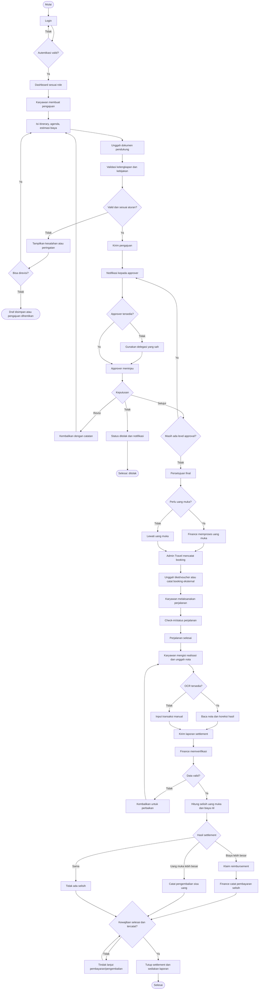

# Perancangan Web Aplikasi

## Corporate Travel Management System (CTMS) — PT Jaya Abadi

**Versi:** 1.0  
**Status:** Rancangan fungsional awal  
**Basis:** Proposal _Pembuatan Aplikasi Perjalanan Dinas (Corporate Travel Management System)_  
**Tujuan dokumen:** Menjadi acuan awal untuk desain UI/UX, basis data, implementasi backend, dan pengujian aplikasi.

---

## 1. Ringkasan Sistem

Corporate Travel Management System (CTMS) adalah aplikasi web responsif untuk mengelola proses perjalanan dinas secara terintegrasi, mulai dari pengajuan, persetujuan, pemesanan, pelaksanaan perjalanan, hingga pertanggungjawaban biaya dan pelaporan.

Sistem menerapkan **Role-Based Access Control (RBAC)** sehingga setiap pengguna hanya dapat mengakses fungsi sesuai role dan kewenangannya.

### 1.1 Tujuan

- Mendigitalkan proses pengajuan perjalanan dinas.
- Mempercepat dan mencatat proses persetujuan.
- Memastikan pengajuan diperiksa terhadap kebijakan dan plafon biaya.
- Menyimpan dokumen perjalanan dan bukti transaksi secara terpusat.
- Mempermudah verifikasi uang muka, reimbursement, dan pengembalian sisa uang.
- Menyediakan dashboard pemantauan dan laporan untuk pengambilan keputusan.

### 1.2 Ruang Lingkup

**Fitur inti:**

1. Login, autentikasi, dan RBAC.
2. Data master karyawan, departemen, jabatan, serta konfigurasi kebijakan perjalanan.
3. Pengajuan perjalanan dinas dan lampiran dokumen.
4. Validasi kebijakan dan plafon anggaran.
5. Persetujuan berjenjang, penolakan, revisi, dan delegasi.
6. Pencatatan uang muka.
7. Pengelolaan booking oleh Admin Travel.
8. Check-in/status perjalanan.
9. Pelaporan realisasi biaya, unggah nota, dan bantuan OCR jika tersedia.
10. Verifikasi Finance, settlement, reimbursement, dan pengembalian sisa uang.
11. Dashboard, audit trail, notifikasi, dan ekspor laporan.

**Fitur opsional/fase berikutnya:**

- Integrasi pemesanan tiket/hotel secara langsung dengan penyedia.
- OCR otomatis untuk membaca nota.
- Integrasi langsung dengan sistem akuntansi/payroll.
- Aplikasi mobile native. Pada tahap awal, antarmuka web responsif dapat digunakan dari ponsel.

> **Catatan ruang lingkup:** Proposal menyebut modul Booking & Fulfillment sebagai Fase 2 (opsional), sedangkan proses Admin Travel tetap menjadi kebutuhan operasional. Jika modul booking belum dibangun, aplikasi perlu tetap menyediakan status dan pencatatan pemesanan manual agar alur perjalanan tidak terputus.

---

## 2. Role dan Hak Akses

Sistem menggunakan lima role utama. Role yang sama dapat diberikan kepada beberapa akun, tetapi setiap akun tetap memiliki identitas dan jejak aktivitas tersendiri.

| Role                    | Tanggung jawab                                                                                                         | Menu utama                                                                                 |
| ----------------------- | ---------------------------------------------------------------------------------------------------------------------- | ------------------------------------------------------------------------------------------ |
| **Karyawan (Traveler)** | Membuat pengajuan, memantau status, melakukan check-in, melaporkan biaya, mengunggah nota, dan menindaklanjuti selisih | Dashboard Saya, Pengajuan, Perjalanan Saya, Settlement Saya, Notifikasi                    |
| **Atasan (Approver)**   | Meninjau pengajuan, menyetujui/menolak/meminta revisi, serta mendelegasikan persetujuan sesuai izin                    | Kotak Persetujuan, Riwayat Persetujuan, Delegasi                                           |
| **Admin Travel**        | Mengelola detail perjalanan, pemesanan tiket/hotel, dan menyimpan e-tiket/voucher                                      | Perjalanan Disetujui, Booking, Dokumen Perjalanan                                          |
| **Finance**             | Memproses uang muka, memverifikasi realisasi biaya, mengelola reimbursement/pengembalian, dan mengekspor laporan       | Uang Muka, Verifikasi Settlement, Pembayaran, Laporan Keuangan                             |
| **Super Admin**         | Mengelola akun, data master, kebijakan, konfigurasi alur approval, dan pemantauan sistem                               | Pengguna & Role, Data Master, Kebijakan, Konfigurasi Workflow, Dashboard Global, Audit Log |

### 2.1 Batas kewenangan

- Karyawan hanya dapat melihat dan mengubah pengajuan miliknya, sesuai status yang diizinkan.
- Atasan hanya dapat memproses pengajuan yang ditugaskan kepadanya atau yang didelegasikan secara sah.
- Admin Travel hanya mengelola kebutuhan perjalanan yang sudah mendapat persetujuan final.
- Finance mengelola transaksi keuangan dan settlement, tetapi tidak boleh mengubah isi bukti transaksi yang diunggah Karyawan tanpa jejak audit.
- Super Admin mengelola konfigurasi dan akses. Perubahan konfigurasi penting harus tercatat dalam audit log.
- Hak akses tidak cukup hanya disembunyikan di antarmuka; backend harus memeriksa izin pada setiap endpoint/aksi.

### 2.2 Klarifikasi role approval

Proposal menyebut contoh Manager → Head → Finance/HR dan persetujuan Direktur untuk nominal besar, tetapi hanya mendefinisikan lima role utama. Agar tidak menambah role formal tanpa keputusan bisnis:

- **Atasan** diperlakukan sebagai role dengan tingkat/hierarki approval yang dapat dikonfigurasi (misalnya Manager, Head, Direktur).
- Finance tetap menjadi role tersendiri untuk pemeriksaan keuangan sesuai aturan perusahaan.
- Keterlibatan HR dan kondisi yang mewajibkan persetujuan Direktur harus ditetapkan sebagai konfigurasi bisnis sebelum implementasi.
- Sistem harus menyimpan siapa approver yang ditugaskan, urutan level, keputusan, waktu, komentar, serta delegasi yang berlaku.

---

## 3. Navigasi dan Halaman

### 3.1 Halaman umum

1. **Login**
   - Email/username dan kata sandi.
   - Pesan kesalahan yang tidak membocorkan apakah akun tertentu terdaftar.
   - Pembatasan percobaan login dan pengelolaan sesi.

2. **Dashboard**
   - Konten berbeda sesuai role.
   - Ringkasan tugas yang menunggu tindakan, status perjalanan, notifikasi, dan statistik yang sesuai izin.

3. **Profil**
   - Informasi dasar akun.
   - Pengubahan kata sandi sesuai kebijakan keamanan.

4. **Notifikasi**
   - Daftar notifikasi, status sudah dibaca, dan tautan ke item terkait.

5. **Pusat Dokumen**
   - Dokumen hanya dapat diakses oleh pemilik dan role yang memiliki kewenangan.
   - File tidak boleh tersedia melalui URL publik yang dapat ditebak.

### 3.2 Halaman Karyawan

- Dashboard Saya.
- Buat Pengajuan.
- Detail Pengajuan dan riwayat status.
- Perjalanan Aktif dan Check-in.
- Dokumen perjalanan (tiket/voucher jika tersedia).
- Buat Laporan Biaya.
- Detail Settlement dan tindak lanjut pengembalian/reimbursement.

### 3.3 Halaman Atasan

- Kotak Persetujuan.
- Detail pengajuan beserta estimasi biaya dan lampiran.
- Setujui, Tolak, atau Minta Revisi dengan alasan.
- Delegasi persetujuan dengan periode mulai/selesai.
- Riwayat keputusan.

### 3.4 Halaman Admin Travel

- Daftar perjalanan yang disetujui final.
- Detail itinerary.
- Input/ubah data booking sesuai izin dan status.
- Unggah e-tiket, voucher, dan konfirmasi vendor.
- Status booking: belum diproses, diproses, terkonfirmasi, gagal/dibatalkan.

### 3.5 Halaman Finance

- Daftar uang muka yang perlu diproses.
- Catatan pembayaran uang muka.
- Antrean settlement yang perlu diverifikasi.
- Detail transaksi dan bukti nota.
- Setujui verifikasi atau kembalikan untuk perbaikan.
- Catat pembayaran reimbursement dan pengembalian sisa uang.
- Laporan keuangan dan ekspor CSV/Excel.

### 3.6 Halaman Super Admin

- Pengguna, role, dan status akun.
- Data master karyawan, departemen, jabatan, serta pusat biaya/proyek jika digunakan.
- Kebijakan perjalanan dan plafon berdasarkan jabatan.
- Aturan approval dan batas nominal.
- Delegasi dan konfigurasi notifikasi.
- Dashboard global, audit log, dan status backup.

---

## 4. Alur Bisnis End-to-End

### 4.1 Ringkasan

1. Karyawan login dan membuat pengajuan.
2. Sistem memvalidasi kelengkapan, dokumen, kebijakan, dan plafon biaya.
3. Pengajuan yang valid masuk ke antrean Atasan.
4. Atasan menyetujui, menolak, atau meminta revisi.
5. Jika diperlukan, pengajuan diteruskan ke level approver berikutnya berdasarkan aturan.
6. Setelah persetujuan final, Finance memproses uang muka jika diperlukan.
7. Admin Travel mencatat atau mengelola pemesanan dan mengunggah dokumen perjalanan.
8. Karyawan menjalankan perjalanan dan memperbarui status check-in.
9. Setelah perjalanan, Karyawan mengirim laporan realisasi biaya dan bukti transaksi.
10. Finance memverifikasi laporan dan bukti.
11. Sistem menghitung selisih uang muka terhadap pengeluaran riil.
12. Finance memproses reimbursement atau mencatat pengembalian sisa uang.
13. Settlement ditutup setelah kewajiban keuangan selesai dan status pembayaran/pengembalian tercatat.
14. Data tersedia di dashboard dan laporan sesuai hak akses.

### 4.2 Flowchart utama

### 4.3 Aturan transisi status

| Status                           | Pemilik tindakan berikutnya                     | Transisi yang diperbolehkan                       |
| -------------------------------- | ----------------------------------------------- | ------------------------------------------------- |
| Draf                             | Karyawan                                        | Edit, simpan, kirim                               |
| Menunggu Approval                | Atasan/approver yang ditugaskan                 | Setujui, tolak, minta revisi                      |
| Perlu Revisi                     | Karyawan                                        | Edit dan kirim ulang                              |
| Ditolak                          | Karyawan sebagai pembaca; pengajuan tidak aktif | Lihat alasan; buat pengajuan baru jika diperlukan |
| Disetujui Final                  | Finance/Admin Travel sesuai tugas               | Proses uang muka dan/atau booking                 |
| Booking Diproses                 | Admin Travel                                    | Perbarui status, unggah dokumen                   |
| Siap Berangkat/Dalam Perjalanan  | Karyawan                                        | Check-in dan pembaruan status                     |
| Menunggu Settlement              | Karyawan                                        | Isi realisasi dan kirim laporan                   |
| Perlu Perbaikan Settlement       | Karyawan                                        | Perbaiki laporan dan kirim ulang                  |
| Menunggu Verifikasi Finance      | Finance                                         | Verifikasi atau kembalikan                        |
| Menunggu Pembayaran/Pengembalian | Finance dan/atau Karyawan sesuai kewajiban      | Catat transaksi hingga selesai                    |
| Settlement Selesai               | Finance                                         | Tutup proses; laporan dapat dilihat sesuai izin   |

> Status di atas merupakan rancangan yang disarankan. Nama status dan aturan transisinya perlu disepakati bersama pemilik proses sebelum pengembangan.

---

## 5. Detail Aturan Bisnis

### 5.1 Pengajuan dan validasi

- Pengajuan harus memiliki tujuan, tanggal, agenda, estimasi biaya, dan dokumen wajib sesuai kebijakan.
- Tanggal kepulangan tidak boleh lebih awal daripada tanggal keberangkatan.
- Sistem menghitung durasi perjalanan dan total estimasi biaya secara konsisten.
- Plafon biaya berasal dari kebijakan yang berlaku untuk jabatan/level yang relevan.
- Jika melebihi plafon, sistem menampilkan rincian pelampauan dan tidak boleh diam-diam meloloskan pengajuan.
- Pilihan tindakan untuk pelampauan harus ditetapkan: blokir, revisi, atau jalur pengecualian dengan persetujuan khusus.
- Perubahan data penting setelah persetujuan final harus memicu penilaian ulang dan, bila diperlukan, approval ulang.
- Sistem harus mencegah pengajuan ganda yang tidak disengaja, tetapi tidak boleh menganggap dua perjalanan berbeda sebagai duplikat hanya berdasarkan kemiripan tanggal.

### 5.2 Approval

- Urutan approver ditentukan oleh konfigurasi berdasarkan struktur organisasi, nominal, departemen/proyek, dan aturan perusahaan.
- Setiap keputusan menyimpan approver, waktu, keputusan, komentar, serta versi data yang dinilai.
- Penolakan wajib disertai alasan.
- Permintaan revisi wajib menyertakan catatan yang dapat ditindaklanjuti.
- Delegasi memiliki periode berlaku, pemberi dan penerima delegasi, serta ruang lingkup kewenangan.
- Sistem harus mencegah approver memproses pengajuan di luar kewenangannya.
- Perubahan konfigurasi workflow dicatat dalam audit log.

**Keputusan yang masih dibutuhkan:** apakah Finance menjadi approver sebelum persetujuan final, hanya memproses uang muka setelah persetujuan final, atau melakukan keduanya pada kondisi tertentu. Proposal menyebut Finance/HR dalam contoh workflow sekaligus mendefinisikan Finance sebagai pengelola transaksi keuangan; aturan final perlu dipastikan.

### 5.3 Uang muka dan booking

- Uang muka bersifat kondisional, sesuai kebijakan dan kebutuhan perjalanan.
- Catatan uang muka minimal memuat jumlah, tanggal, penerima, referensi pengajuan, status, dan bukti transaksi pembayaran jika tersedia.
- Booking hanya dilakukan setelah approval final.
- Admin Travel mencatat vendor, biaya, referensi booking, status, dan dokumen tiket/voucher.
- Jika booking eksternal, sistem tetap menyimpan data dan dokumen hasil booking.
- Pembatalan atau perubahan itinerary setelah booking harus memiliki alasan dan jejak audit.
- Perlu ditetapkan apakah Admin Travel boleh mengubah biaya/itinerary dan kapan perubahan itu membutuhkan approval ulang.

### 5.4 Check-in dan status perjalanan

- Karyawan dapat memperbarui status ketika tiba di tujuan/hotel.
- Catat waktu check-in dan konteks lokasi yang dimasukkan atau disediakan oleh fitur yang benar-benar diimplementasikan.
- Jangan mengklaim pelacakan GPS otomatis jika izin lokasi, desain teknis, dan kebijakan privasi belum ditetapkan.
- Tentukan penanganan ketika Karyawan lupa check-in atau mengalami kendala jaringan.
- Status perjalanan hanya terlihat oleh role yang memiliki kewenangan.

### 5.5 Settlement, reimbursement, dan pengembalian

Definisi perhitungan:

- `U` = uang muka yang telah dibayarkan kepada Karyawan.
- `R` = total pengeluaran riil yang disetujui Finance.
- `S = R - U` = selisih settlement.

Aturan:

- Jika `S > 0`, terdapat selisih yang berpotensi dibayarkan sebagai reimbursement.
- Jika `S < 0`, terdapat sisa uang muka yang harus dikembalikan sesuai kebijakan.
- Jika `S = 0`, tidak ada selisih yang perlu dibayar atau dikembalikan.

Nilai reimbursement akhir tidak otomatis sama dengan seluruh pengeluaran yang diklaim. Finance hanya menghitung pengeluaran yang valid dan dapat ditanggung menurut kebijakan.

- Setiap transaksi harus memiliki tanggal, nominal, kategori, deskripsi/vendor, dan bukti bila diwajibkan.
- Koreksi OCR harus dapat dilacak; hasil OCR tidak dianggap benar tanpa pemeriksaan.
- Pengeluaran yang ditolak harus memiliki alasan.
- Settlement baru berstatus selesai jika verifikasi selesai dan kewajiban pembayaran/pengembalian telah dipenuhi atau status penyelesaiannya secara eksplisit disetujui menurut kebijakan.
- Jika pengembalian uang dilakukan melalui rekening perusahaan, simpan referensi/bukti penerimaan. Metode pengembalian final perlu ditentukan perusahaan.

### 5.6 Notifikasi

Kirim notifikasi untuk peristiwa penting, misalnya:

- Pengajuan berhasil dikirim.
- Approval menunggu tindakan.
- Pengajuan disetujui, ditolak, atau perlu revisi.
- Delegasi digunakan.
- Booking dikonfirmasi atau berubah.
- Jadwal perjalanan mendekat.
- Laporan settlement perlu dikirim atau direvisi.
- Finance menyelesaikan verifikasi atau mencatat pembayaran.
- Batas anggaran mendekati plafon.

Notifikasi bukan pengganti status pada database. Status transaksi tetap menjadi sumber kebenaran utama.

---

## 6. Rancangan Data / Entitas Utama

Rancangan ini bersifat konseptual, bukan skema database final.

| Entitas                  | Isi utama                                                                             | Relasi penting                                    |
| ------------------------ | ------------------------------------------------------------------------------------- | ------------------------------------------------- |
| `users`                  | Identitas login, nama, email, status akun, hash kata sandi                            | Terhubung dengan role dan data karyawan           |
| `roles` / `permissions`  | Role dan izin granular                                                                | Mengatur akses ke fungsi                          |
| `employees`              | NIK internal, departemen, jabatan, atasan, status kerja                               | Terhubung dengan pengguna                         |
| `departments`            | Data departemen                                                                       | Direferensikan pengajuan dan laporan              |
| `travel_policies`        | Plafon, kategori biaya, aturan berdasarkan level dan periode berlaku                  | Digunakan oleh validasi pengajuan                 |
| `travel_requests`        | Pemilik, tujuan, tanggal, agenda, estimasi, status, pusat biaya/proyek bila digunakan | Memiliki approval, dokumen, booking               |
| `travel_request_items`   | Rincian estimasi biaya per kategori                                                   | Milik pengajuan                                   |
| `attachments`            | Lokasi file, tipe dokumen, ukuran, pemilik, checksum opsional                         | Terhubung ke pengajuan/settlement                 |
| `approval_steps`         | Level, approver yang ditugaskan, status, keputusan, komentar, waktu                   | Milik pengajuan                                   |
| `approval_delegations`   | Pemberi, penerima, periode, ruang lingkup, status                                     | Dipakai oleh workflow                             |
| `cash_advances`          | Jumlah uang muka, tanggal, status, referensi pembayaran                               | Terhubung ke pengajuan                            |
| `bookings`               | Vendor, jenis layanan, referensi, biaya, status, catatan                              | Terhubung ke pengajuan                            |
| `travel_checkins`        | Waktu, status, lokasi sesuai fitur yang disetujui                                     | Terhubung ke perjalanan                           |
| `expense_reports`        | Total klaim, status verifikasi, tanggal pengiriman                                    | Terhubung ke pengajuan                            |
| `expense_items`          | Tanggal, vendor, kategori, nominal, hasil OCR, nominal koreksi                        | Milik laporan biaya                               |
| `settlements`            | Uang muka, biaya disetujui, selisih, status akhir                                     | Terhubung ke pengajuan dan laporan biaya          |
| `financial_transactions` | Jenis transaksi, nominal, tanggal, referensi, bukti, status                           | Pembayaran uang muka, reimbursement, pengembalian |
| `notifications`          | Penerima, pesan, waktu, status baca, referensi item                                   | Terhubung ke pengguna                             |
| `audit_logs`             | Aktor, aksi, objek, waktu, metadata yang aman                                         | Mencatat perubahan penting                        |

### 6.1 Prinsip integritas data

- Gunakan primary key dan foreign key yang konsisten.
- Nominal uang disimpan dalam tipe desimal yang sesuai, bukan floating point.
- Simpan waktu transaksi dengan aturan zona waktu yang konsisten.
- Hindari menghapus permanen transaksi yang sudah dipakai untuk audit; gunakan status pembatalan atau arsip sesuai kebijakan.
- Perubahan status dan pencatatan transaksi keuangan harus berlangsung dalam transaksi database bila perlu untuk menjaga konsistensi.
- File bukti disimpan dengan akses terkendali, validasi tipe/ukuran, dan nama file yang tidak dapat diprediksi.
- Data sensitif tidak dicatat sembarangan dalam log.

---

## 7. Rancangan Dashboard per Role

| Role         | Ringkasan dashboard                                                                                                                                            |
| ------------ | -------------------------------------------------------------------------------------------------------------------------------------------------------------- |
| Karyawan     | Pengajuan draf, menunggu approval, perjalanan aktif, laporan biaya yang belum dikirim, settlement yang perlu ditindaklanjuti                                   |
| Atasan       | Jumlah approval menunggu tindakan, pengajuan berdasarkan status, total estimasi biaya untuk item yang menjadi kewenangannya                                    |
| Admin Travel | Perjalanan disetujui yang belum dibooking, booking diproses, dokumen belum lengkap, perubahan booking                                                          |
| Finance      | Uang muka menunggu proses, settlement menunggu verifikasi, reimbursement menunggu pembayaran, pengembalian yang belum terkonfirmasi                            |
| Super Admin  | Jumlah perjalanan per periode, pengeluaran berdasarkan departemen/proyek/individu sesuai izin, tren anggaran, peringatan plafon, rekap vendor, aktivitas audit |

Setiap statistik harus menggunakan definisi status yang sama dengan workflow. Data lintas departemen atau individu hanya ditampilkan sesuai kewenangan dan kebijakan privasi perusahaan.

---

### 8.1 Keamanan minimum

- Hash kata sandi dengan algoritma bawaan framework yang direkomendasikan.
- CSRF protection, validasi input, dan query parameterized/ORM.
- Rate limiting untuk login dan endpoint sensitif.
- Validasi otorisasi di backend untuk setiap data dan aksi.
- Validasi file berdasarkan ukuran, MIME/type, dan ekstensi yang diizinkan.
- Penyimpanan dokumen privat dengan pemeriksaan izin saat diunduh.
- Audit log untuk perubahan penting.
- Backup dan uji pemulihan berkala.
- Masa simpan data dan dokumen ditentukan oleh kebijakan perusahaan.
- Hindari memasukkan kata sandi, token, atau isi dokumen sensitif ke dalam log.

---

## 9. Rancangan Pengujian Penerimaan

| ID    | Skenario                                                                       | Hasil yang diharapkan                                                    |
| ----- | ------------------------------------------------------------------------------ | ------------------------------------------------------------------------ |
| TC-01 | Login dengan kredensial valid                                                  | Pengguna masuk ke dashboard sesuai role                                  |
| TC-02 | Karyawan mencoba membuka data pengajuan milik orang lain                       | Akses ditolak kecuali diizinkan oleh kebijakan                           |
| TC-03 | Pengajuan tidak memiliki dokumen wajib                                         | Sistem menunjukkan kekurangan dan mencegah pengiriman jika dokumen wajib |
| TC-04 | Estimasi melampaui plafon                                                      | Sistem menerapkan aturan plafon yang telah dikonfigurasi                 |
| TC-05 | Atasan meminta revisi                                                          | Status dan catatan revisi tersimpan; Karyawan menerima notifikasi        |
| TC-06 | Atasan menolak pengajuan                                                       | Alasan penolakan tersimpan dan proses approval berakhir                  |
| TC-07 | Approval membutuhkan beberapa level                                            | Setiap level berjalan berurutan sesuai konfigurasi                       |
| TC-08 | Approver tidak tersedia dan delegasi sah aktif                                 | Tugas diberikan kepada delegasi yang berwenang                           |
| TC-09 | Admin Travel mencoba memproses pengajuan yang belum disetujui final            | Sistem menolak aksi                                                      |
| TC-10 | OCR menghasilkan nominal yang salah                                            | Karyawan dapat mengoreksi; perubahan dapat ditelusuri                    |
| TC-11 | Finance mengembalikan settlement                                               | Karyawan melihat alasan dan dapat memperbaiki laporan                    |
| TC-12 | Biaya riil lebih besar daripada uang muka                                      | Sistem menghitung selisih positif dengan benar                           |
| TC-13 | Uang muka lebih besar daripada biaya riil                                      | Sistem menghitung sisa uang yang harus dikembalikan                      |
| TC-14 | Selisih nol                                                                    | Sistem tidak membuat kewajiban pembayaran selisih                        |
| TC-15 | Pengguna tanpa izin mengunduh dokumen privat                                   | Sistem menolak akses                                                     |
| TC-16 | Laporan diekspor                                                               | Data dan total sesuai filter, izin, dan data yang tersimpan              |
| TC-17 | Perubahan kebijakan dilakukan Super Admin                                      | Perubahan tercatat dan berlaku sesuai tanggal/versi kebijakan            |
| TC-18 | Proses settlement belum memiliki bukti pembayaran/pengembalian yang diwajibkan | Settlement tidak dapat ditutup sebelum syarat terpenuhi                  |

---

## 10. Keputusan yang telah dibuat

1. Hierarki Approval: Karyawan → Atasan langsung → Atasan tingkat berikutnya jika diperlukan. Batas nominal approval dapat dikonfigurasi oleh Super Admin.
2. Peran Finance/HR: Atasan bertanggung jawab atas persetujuan perjalanan, sedangkan Finance memverifikasi anggaran, memproses uang muka, dan melakukan settlement.
3. Plafon Biaya: Setiap jabatan memiliki plafon biaya berdasarkan kategori perjalanan. Pengajuan yang melebihi plafon memerlukan persetujuan khusus.
4. Uang Muka: Bersifat opsional, sesuai kebutuhan perjalanan dan kebijakan perusahaan.
5. Booking Fase 1: Admin Travel mencatat booking eksternal secara manual dan mengunggah tiket atau voucher.
6. Settlement: Laporan biaya wajib dikirim maksimal 7 hari kalender setelah perjalanan selesai. Finance dapat mengembalikan laporan untuk revisi.
7. Pengembalian Sisa Uang: Dilakukan melalui transfer ke rekening perusahaan dengan bukti pembayaran.
8. Check-in: Menggunakan tombol status manual tanpa GPS pada rilis awal.
9. OCR: Ditunda ke fase berikutnya; pencatatan nota dilakukan secara manual.
10. Notifikasi: Menggunakan notifikasi dalam aplikasi dan email.
11. Retensi Data: Dokumen dan transaksi disimpan sesuai kebijakan retensi perusahaan serta ketentuan yang berlaku.
12. Integrasi Eksternal: Rilis awal cukup menyediakan ekspor laporan CSV/Excel tanpa integrasi langsung ke sistem akuntansi atau payroll.

---

## 11. Tahapan Implementasi yang Disarankan

Tahapan berikut menyelaraskan fitur dengan urutan kerja dalam proposal. Durasi adalah estimasi proposal dan perlu divalidasi kembali setelah ruang lingkup diputuskan.

| Fase                      | Fokus                                                                                      | Keluaran                                  |
| ------------------------- | ------------------------------------------------------------------------------------------ | ----------------------------------------- |
| 1. Analisis & desain      | Konfirmasi requirement, role, aturan approval, kebijakan, wireframe, dan rancangan data    | SRS, flowchart final, wireframe, ERD awal |
| 2. Fondasi & master data  | Login, RBAC, data karyawan, kebijakan, dashboard awal, audit log                           | Fondasi aplikasi dan konfigurasi          |
| 3. Pengajuan & approval   | Form pengajuan, validasi, lampiran, notifikasi, approval berjenjang, delegasi              | Modul pengajuan dan workflow              |
| 4. Finance & pelaporan    | Uang muka, settlement, reimbursement, bukti transaksi, ekspor laporan, OCR jika disepakati | Modul Finance dan laporan                 |
| 5. Pengujian & QA         | UAT, pengujian hak akses, perbaikan bug, pengujian keamanan                                | Aplikasi stabil dan laporan UAT           |
| 6. Deployment & pelatihan | Rilis produksi, backup, dokumentasi, pelatihan role, serah terima                          | Aplikasi produksi dan manual pengguna     |

---

## 12. Kriteria Selesai (Definition of Done)

Fitur dianggap siap digunakan jika:

- Alur utama telah lolos pengujian penerimaan.
- Role dan izin telah diuji di backend, bukan hanya pada tampilan.
- Semua transisi status memiliki aturan yang jelas dan jejak audit.
- Perhitungan biaya, uang muka, reimbursement, dan pengembalian telah diuji.
- Dokumen privat tidak dapat diakses oleh pengguna tanpa izin.
- Notifikasi dan penanganan kegagalan tercatat.
- Backup dapat dipulihkan melalui uji pemulihan.
- Dokumentasi penggunaan dan administrasi tersedia.
- Pemilik proses menyetujui hasil UAT.

